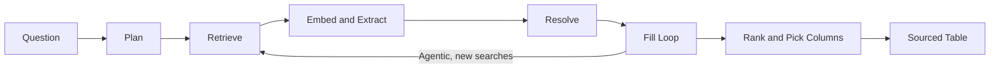

<h1 align="center">
  <br>
  Agentic AI Search
  <br>
</h1>

<h4 align="center">Ask a question and get a table where every value links to the page and quote it came from.</h4>

<p align="center">
  <a href="https://www.python.org/">
    
  </a>
  <a href="https://fastapi.tiangolo.com/">
    
  </a>
  <a href="https://groq.com/">
    
  </a>
  <a href="https://tavily.com/">
    
  </a>
  <a href="https://github.com/facebookresearch/faiss">
    
  </a>
  <a href="https://developer.mozilla.org/en-US/docs/Web/JavaScript">
    
  </a>
  <a href="https://huggingface.co/spaces">
    
  </a>
</p>

<p align="center">
  <a href="#what-it-does">What It Does</a>
  •
  <a href="#how-it-works">How It Works</a>
  •
  <a href="#setup">Setup</a>
  •
  <a href="#design-choices">Design Choices</a>
  •
  <a href="#known-limitations">Known Limitations</a>
</p>

<p align="center">
  <strong>Live Demo</strong> <a href="https://srikarprabhas-cite-table.hf.space">srikarprabhas-cite-table.hf.space</a>
  <br>
  <sub>Runs on a free Hugging Face Space. The first visit after a quiet spell takes a moment to wake up.</sub>
</p>

---

## What It Does

You type a question like "AI startups in healthcare" or "cheap pizza in Brooklyn". The app plans the columns, searches the web, reads the pages and builds a table of up to 10 rows.

Every cell links to the page it came from and the exact quote that supports it. If no page supports a value, the cell stays empty. The app never fills a cell from the model's memory.

There are two modes.

| Mode | What it does | LLM calls |
|---|---|---|
| Fast | One search, one fill pass | 3 |
| Agentic | Searches again for missing cells, up to 3 fill rounds | up to 6 |

---

## How It Works



| Stage | File | LLM | What it does |
|---|---|---|---|
| Plan | `planner.py` | 1 call | Picks 7 or 8 columns people compare, writes 3 search queries and turns filters in the question into rank rules |
| Retrieve | `retriever.py` | none | Runs 2 Tavily queries with page text, and the backup query if too few pages come back |
| Embed and Extract | `embedder.py`, `extractor.py` | 1 call | Splits pages into chunks, puts them in a FAISS index, sends the best chunks in one call and gets rows with quotes |
| Resolve | `resolver.py` | none | Merges rows that name the same thing, using name cleanup, fuzzy match, a website check and rare word overlap |
| Fill Loop | `filler.py` | 1 to 3 calls | Finds empty cells, pulls chunks that name that row from FAISS, fills them in one call and checks every quote |
| Rank | `ranker.py` | none | Scores rows by the rules they meet, then by meaning, sources and fullness, and keeps only full columns |

### Plan
One call returns the entity type, the columns, 3 queries and the rank rules. Lookup columns like phone or address are removed, since they waste a column. Rules come in three kinds, a location with its main sub-areas, a number limit like price at most 2, and keywords like pizza. The code checks each rule against the planned columns and drops any that do not match.

### Retrieve
Tavily returns the page text along with each result. We clean out images, links and menu lines, and keep up to 8,000 characters per page. If the 2 main queries find fewer than 4 pages, the backup query runs.

### Embed and Extract
Pages are split into 90 word chunks with 20 words of overlap. A small local model (`bge-small-en-v1.5` via fastembed) embeds them into an in-memory FAISS index made for that one search. The extractor sends the best chunks, up to 3,000 tokens, in a single call. Each row comes back with a chunk number and a quote for every value. Values like "unknown" or "N/A" are thrown away.

### Resolve
No LLM here. Two rows are the same thing when their cleaned names match, or are very close (a fuzzy score of 0.92 or more), or share rare words. A different website for each one blocks the merge. Groups are formed with union-find. For each cell the merged value is the one most sources agree on, and only the sources that agree are kept.

### Fill Loop
For every empty cell, FAISS looks up chunks for "row name plus column". A chunk is used only if it names that row, and it is trimmed to the sentences around the name. One call fills all cells together. A value is kept only if its quote is in the chunk, every word of the value is in the quote, and every number matches exactly.

In Agentic mode the loop runs up to 3 times. Each round searches Tavily for the rows that still have gaps, adds the new pages to the index and fills again. It stops when nothing is empty, when a round fills nothing, or when there are no new pages. If the first pass finds fewer than 8 rows, Agentic also runs the backup query and extracts again.

### Rank
No LLM here either. Each row gets one point per rule it meets, checked on whole words. Price signs like "$$" count as 2, and 5M or 1.5B become real numbers. Ties are broken by how close the row is in meaning to the question, then by source count, then by how full the row is. The top 10 are kept. Columns are shown only if a rule uses them or every row has them filled. The table shows a Match badge like 3/3 and the rules as pills.

### Token budget
The Groq free tier allows about 8,000 tokens a minute. A shared pacer in `config.py` keeps a 60 second window with a limit of 7,900. Before each call it reserves the worst case and waits if that would go over. After the call it records the real usage. In Fast mode the fill call uses whatever is left of the minute.

---

## Setup

You need Python 3.12, a Groq API key and a Tavily API key. Both have free tiers.

```bash
git clone https://github.com/srikarprabhaskandagatla/agentic-ai-search.git
cd agentic-ai-search
pip install -r requirements.txt
cp backend/.env.example backend/.env
```

Put your keys in `backend/.env` as `GROQ_API_KEY` and `TAVILY_API_KEY`, then start the app.

```bash
python app.py
```

The backend serves the frontend too. Open `localhost` on port 7860 in your browser.

### Tests

```bash
pip install pytest pytest-asyncio
pytest tests -q
```

There are 91 tests. All LLM, search and embedding calls are faked, and no API keys are needed.

### Deploy

The live demo is a Hugging Face Space. `app.py` is the entry point, and the keys are stored as Space secrets. The root `README.md` holds the Space settings, and this file is what GitHub shows.

---

## Design Choices

**Every cell needs a quote.** LLMs make up facts. The extractor and the filler must return a quote for each value, and the user can open it from the cell. For filled cells the code also checks that the quote is really in the chunk. A cell with no proof stays empty.

**Few LLM calls.** An early version made about 38 calls per search. Now Fast makes 3 and Agentic makes up to 6. Merging, ranking and column picking are plain code. They are fast, give the same result every run and are easy to test.

**Tokens, not calls, are the limit.** On the free tier the token cap is hit long before the call cap. That is why each call gets only the best chunks under a fixed budget instead of whole pages.

**Embeddings stay local.** The embedding model runs on CPU inside the app. It loads once at startup, and each search builds its own small FAISS index that is freed afterward.

**Columns people compare.** The planner avoids lookup fields and rarely public facts like revenue. Columns that end up mostly empty are hidden, which keeps the table full without guessing.

**Plain HTML, CSS and JavaScript.** One page and one data flow do not need a framework or a build step. Progress streams over Server-Sent Events.

---

## Known Limitations

- **At most 10 rows.** Good for a summary, not for a full list.
- **Free tier speed.** When the minute's token budget is used up, the pacer waits. A busy minute can add some seconds.
- **Location matching uses words.** A row passes the location rule only if its cell names the place or one of the sub-areas the planner listed.
- **Empty is better than wrong.** Cells with no quote in the found pages stay empty, even when the answer is well known.
- **English only.** Prompts and the embedding model are in English.
- **No login or rate limit.** Anyone with the link uses the same API keys.
- **No cache across searches.** The same page may be fetched again in a later search.
